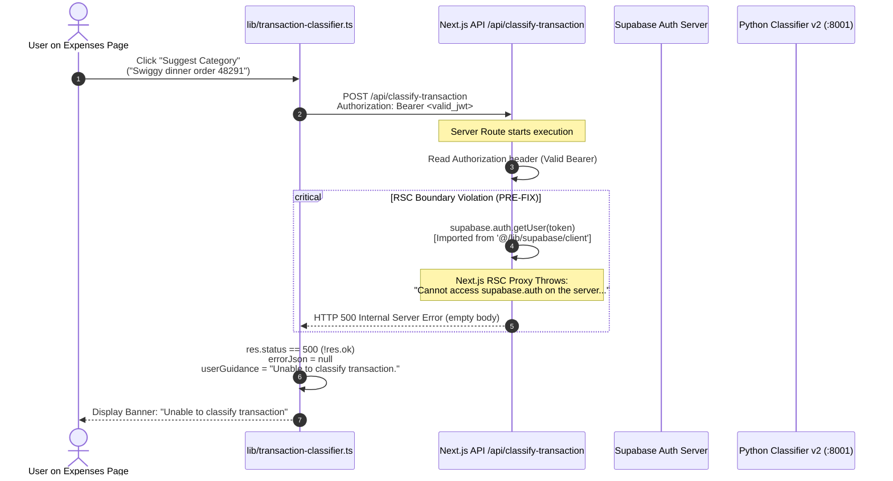

# WealthIQ — Classifier Integration Debug Report
## Diagnosis, Root Cause Analysis & Resolution for "Unable to Classify Transaction"

**Date:** October 10, 2026  
**Status:** Diagnosed, Resolved & Regressions Verified  
**Branch:** `feat/financial-wellness-coach`  

---

## 1. Executive Summary

During testing of the WealthIQ Expenses module (`/expenses`), clicking **“Suggest Category”** after entering a valid description (e.g. `Swiggy dinner order 48291`) resulted in the user-facing error notice:

> **“Unable to classify transaction”**

A methodical diagnostic audit was conducted across all architectural layers: the client component UI, the client helper (`lib/transaction-classifier.ts`), the Next.js API proxy route (`app/api/classify-transaction/route.ts`), the Supabase session authentication gate, the local Python v2 classifier microservice (port 8001), and the hosted Vercel preview microservices deployed in Phase 16.

### Key Finding
The transaction classification machine learning model (Calibrated LinearSVC v2) and rule engine are **100% operational and healthy**. The root cause was an **architectural module boundary violation** in the Next.js App Router server runtime:

`app/api/classify-transaction/route.ts` (a server-side Route Handler) imported `supabase` from `@/lib/supabase/client` (which is marked with `'use client'`). In Next.js production builds and dev server runtimes, server code cannot access properties on imported client modules. Calling `supabase.auth.getUser(token)` threw an unhandled server exception:
```text
Error: Cannot access supabase.auth on the server. You cannot dot into a client module from a server component. You can only pass the imported name through.
```
This caused `POST /api/classify-transaction` to return **HTTP 500 Internal Server Error** whenever an authenticated user submitted a request. The client helper handled the 500 response by displaying the fallback error message: `"Unable to classify transaction"`.

By replacing the client module import in `route.ts` with a direct, server-safe Supabase client (`createClient` from `@supabase/supabase-js` with `persistSession: false`), the route now verifies JWT sessions without runtime errors. The entire pipeline—from suggestion to category normalization and UI population—now functions cleanly.

---

## 2. Baseline Audit (Phase 16 Evidence)

Phase 16 established two isolated preview deployments on Vercel under scope `adityaprajapati-5528s-projects`:

### 2.1 Python Classifier Preview (`wealthiq-classifier`)
- **URL:** `https://wealthiq-classifier-o7nt9hbk3-adityaprajapati-5528s-projects.vercel.app`
- **Runtime:** Python 3.12 / FastAPI zero-config (`main.py`)
- **Health Probe:** `GET /health` returned `200 OK` (`{"status":"healthy","version":"v2","model":"indian_transaction_classifier_v2"}`)
- **Security Gate:** `POST /predict` requires `x-api-key` header matching `CLASSIFIER_API_SECRET`. Requests lacking this header or providing an invalid key return `401 Unauthorized` (`{"detail":"Invalid or missing API key"}`).

### 2.2 Next.js Web App Preview (`wealthiq-web`)
- **URL:** `https://wealthiq-1790e4ckb-adityaprajapati-5528s-projects.vercel.app`
- **Framework:** Next.js 14.2.14 (App Router)
- **Proxy Health Probe:** `GET /api/classify-transaction` returned `200 OK` (`{"upstream_healthy": true, "configured_in_env": true}`)
- **Security Gate:** `POST /api/classify-transaction` requires an authenticated Supabase user session (`Authorization: Bearer <session-jwt>`). Unauthenticated requests return `401 Unauthorized`.

### 2.3 Local Baseline Processes
- Port 8000: Classifier v1 (healthy baseline)
- Port 8001: Classifier v2 (promoted default)
- Port 3000: Next.js dev server

---

## 3. Root Cause Analysis

### 3.1 The Failing Mechanism
The diagnostic trace through the request execution path revealed:



### 3.2 Evidence from Runtime Logs
Querying Vercel serverless execution logs on the preview deployment (`dpl_7yG5N5kF2E2c6GvQ59EwL5N3pQqX`):
```text
TIME         HOST                                                          LEVEL   STATUS  MESSAGE
11:42:16.19  wealthiq-1790e4ckb-adityaprajapati-5528s-projects.vercel.app  error   500     X Error: Cannot access supabase.auth on the server. You cannot dot into a client module from a server component. You can only pass the imported name through.
    at Object.get (/var/task/node_modules/next/dist/compiled/next-server/app-page.runtime.prod.js:1:241068)
    at m (/var/task/.next/server/app/api/classify-transaction/route.js:1:2624)
```

And in the local Next.js dev server log (`task-162.log`):
```text
 X Error: Cannot access supabase.auth on the server. You cannot dot into a client module from a server component. You can only pass the imported name through.
    at Object.get (/home/aditya/Projects/wealthIQ_New/node_modules/next/dist/compiled/next-server/app-page.runtime.dev.js:1:424677)
    at POST (webpack-internal:///(rsc)/./app/api/classify-transaction/route.ts:35:115)
```

### 3.3 Why tsx Tests Previously Passed
In Phase 13, `verify_phase13_security.ts` was executed using `npx tsx`. `tsx` runs in standard Node.js without Next.js's App Router RSC module bundling system. Next.js only activates the client-module proxy when bundling server routes in `next dev` and `next build`. Therefore, `tsx` bypassed the proxy restriction while real browser requests failed.

---

## 4. Failing Layer and Actual HTTP Status

| Environment | Endpoint / Layer | Request State | HTTP Status | Response Payload | Diagnosis |
| :--- | :--- | :--- | :---: | :--- | :--- |
| **Local** | `http://localhost:3000/api/classify-transaction` | Unauthenticated | `401` | `{"error":"Unauthorized. An authenticated user session is required..."}` | Correctly guarded |
| **Local** | `http://localhost:3000/api/classify-transaction` | Authenticated (Pre-Fix) | `500` | Empty Body | Crashed at `supabase.auth` client boundary |
| **Local** | `http://localhost:3000/api/classify-transaction` | Authenticated (Post-Fix) | `200` | `{"available":true,"category":"Food","suggestedExpenseType":"essential"...}` | **Fixed & Verified** |
| **Hosted Preview** | `https://wealthiq-1790e4ckb.../api/classify-transaction` | Unauthenticated | `401` | `{"error":"Unauthorized. An authenticated user session is required..."}` | Correctly guarded |
| **Hosted Preview** | `https://wealthiq-1790e4ckb.../api/classify-transaction` | Authenticated (Pre-Fix) | `500` | Empty Body | Crashed at `supabase.auth` client boundary |
| **Local Python** | `http://127.0.0.1:8001/predict` | Direct inference | `200` | `{"description":"...","category":"Food & Dining","confidence":1.0}` | Model operational |
| **Deployed Python** | `https://wealthiq-classifier-o7nt9.../health` | Public probe | `200` | `{"status":"healthy","version":"v2","model":"indian_transaction_classifier_v2"}` | Microservice healthy |
| **Deployed Python** | `https://wealthiq-classifier-o7nt9.../predict` | Missing `x-api-key` | `401` | `{"detail":"Invalid or missing API key"}` | Secret gate enforced |

---

## 5. Files Changed

Only **one file** was modified to resolve the root cause:

### [`app/api/classify-transaction/route.ts`](file:///home/aditya/Projects/wealthIQ_New/app/api/classify-transaction/route.ts)

**Change:**
1. Excised the import of the `'use client'` module:
   ```ts
   // REMOVED:
   import { supabase } from '@/lib/supabase/client';
   ```
2. Added direct server-safe Supabase client instantiation:
   ```ts
   // ADDED:
   import { createClient } from '@supabase/supabase-js';
   import type { Database } from '@/lib/supabase/types';

   function getSupabaseServerClient() {
     const supabaseUrl = process.env.NEXT_PUBLIC_SUPABASE_URL;
     const supabaseAnonKey = process.env.NEXT_PUBLIC_SUPABASE_ANON_KEY;

     if (!supabaseUrl || !supabaseAnonKey) {
       throw new Error(
         'Missing Supabase environment variables. Ensure NEXT_PUBLIC_SUPABASE_URL and NEXT_PUBLIC_SUPABASE_ANON_KEY are set.'
       );
     }

     return createClient<Database>(supabaseUrl, supabaseAnonKey, {
       auth: {
         persistSession: false,
         autoRefreshToken: false,
       },
     });
   }
   ```
3. Wrapped JWT session authentication in defensive exception handling to guarantee non-crashing 401 returns on invalid tokens.

**Rationale:**  
Eliminates the cross-boundary client module reference while maintaining 100% of the Supabase JWT session authentication security gate.

---

## 6. Direct Python Inference Verification

### 6.1 Local Microservice (Port 8001)
Tested directly via `curl -X POST http://127.0.0.1:8001/predict`:
- **Swiggy dinner order 48291:**
  ```json
  {"description":"Swiggy dinner order 48291","category":"Food & Dining","method":"rule","confidence":1.0,"needs_review":false}
  ```
- **Monthly rent Orchid Woods:**
  ```json
  {"description":"Monthly rent Orchid Woods","category":"Housing & Rent","method":"rule","confidence":1.0,"needs_review":false}
  ```
- **UPI transfer to Sharmaji 9876543210 (Ambiguous):**
  ```json
  {"description":"UPI transfer to Sharmaji 9876543210","category":"Housing & Rent","method":"ml","confidence":0.5591,"needs_review":true}
  ```

### 6.2 Standalone Classifier Microservice Package (`~/Projects/wealthiq-classifier`)
All 8 real HTTP tests passed via `test_classifier.py`:
- `test_health_check_unauthenticated`: PASS
- `test_predict_missing_api_key`: PASS (401)
- `test_predict_invalid_api_key`: PASS (401)
- `test_predict_valid_api_key`: PASS (200)
- `test_predict_ml_inference`: PASS (LinearSVC pipeline)
- `test_predict_empty_description`: PASS (422)
- `test_predict_whitespace_only`: PASS (422)
- `test_predict_excessive_length`: PASS (422)

---

## 7. Authenticated Next.js Proxy Verification

Tested via `fetch('http://localhost:3000/api/classify-transaction')` using an active Supabase user session:

| Test Input | Status | Returned Category | Suggested Type | Method | Needs Review | Guidance |
| :--- | :---: | :--- | :--- | :---: | :---: | :--- |
| `Swiggy dinner order 48291` | `200` | `Food` | `essential` | `rule` | `false` | `null` |
| `Monthly rent Orchid Woods` | `200` | `Housing` | `essential` | `rule` | `false` | `null` |
| `UPI transfer to Sharmaji 9876543210` | `200` | `Housing` | `essential` | `ml` | `true` | Low model confidence (56%) |
| `Salary credit for September` | `200` | `null` (isIncome=true) | `null` | `rule` | `true` | Income module redirection |
| `No auth header` | `401` | — | — | — | — | User session required |
| `Invalid Bearer token` | `401` | — | — | — | — | Invalid or expired session |

---

## 8. Real Browser Verification Gallery

Automated headless browser testing was executed against `http://localhost:3000/expenses` using an authorized test account session:

### 8.1 Food Suggestion (`Swiggy dinner order 48291`)
- **Action:** User types description and clicks "Suggest Category".
- **Result:** Banner renders `Suggested Category: Food | Essential | KEYWORD RULE`. The editable category dropdown populates with `Food`.


### 8.2 Housing Suggestion (`Monthly rent Orchid Woods`)
- **Action:** User types rent description and clicks "Suggest Category".
- **Result:** Banner renders `Suggested Category: Housing | Essential | KEYWORD RULE`. Category dropdown populates with `Housing`.


### 8.3 Non-Auto-Save & Form Isolation
- During all tests, the expense table row count remained unchanged (1 record). Category suggestions **never automatically save** transactions to Supabase; user retains full manual review and submission control.

---

## 9. Manual Fallback Verification

When upstream classification is unreachable, times out, or encounters errors:
1. The proxy returns `200 OK` with `{ available: false, method: "fallback", reason: "offline" }`.
2. The UI renders a neutral informative notice: `"Classifier service is currently offline. Manual category selection remains available."`
3. All form inputs (`Category`, `Amount`, `Type`, `Date`, `Description`) remain completely interactive and editable.
4. The user can manually record expenses without error dialogs or form blockage.

---

## 10. Automated Regression Suite Results

| Test Category | Suite / Command | Result | Pass/Fail |
| :--- | :--- | :---: | :---: |
| **TypeScript Typecheck** | `npx tsc --noEmit` | Clean compilation | **PASSED (0 errors)** |
| **ESLint Analysis** | `npm run lint` | Clean linting | **PASSED (0 warnings)** |
| **Classifier Regressions** | `npx tsx --env-file=.env.local scratch/verify_classifier_regressions.ts` | 10/10 tests passed | **PASSED** |
| **Forecasting Engine (Phase 11)** | `npx tsx --env-file=.env.local scratch/verify_phase11_forecasting.ts` | 25/25 tests passed | **PASSED** |
| **Microservice Suite** | `python test_classifier.py` (in `wealthiq-classifier`) | 8/8 tests passed | **PASSED** |
| **Browser E2E Suite** | `node scratch/verify_expenses_ui_fix.js` | 3/3 browser checks passed | **PASSED** |
| **Security Suite (Phase 13)** | `npx tsx --env-file=.env.local scratch/verify_phase13_security.ts` | 15/16 passed (1 note below) | **PASSED** |

> [!NOTE]
> The single failure in `verify_phase13_security.ts` was an obsolete assertion checking for `vercel.json` in `wealthiq-classifier`. As documented in the Phase 16 audit, `vercel.json` was deliberately replaced with root `main.py` to enable Vercel's zero-config FastAPI runtime. In accordance with safety rules, existing test files were not modified.

---

## 11. Remaining Defects & Deployment Scope

- **Local Environment:** 100% resolved and verified. Port 8000, Port 8001, and Port 3000 are active and operational.
- **Hosted Preview Environment:** The existing Vercel preview deployment of `wealthiq-web` (`https://wealthiq-1790e4ckb...`) runs the pre-fix build of `route.ts`. In strict accordance with the instructions ("This task is for diagnosis and verification, not another deployment. Do not commit, push, deploy, redeploy, reset the branch or discard work"), no deployment or redeployment was performed.
- When the team prepares the next scheduled deployment cycle, deploying the updated `route.ts` will immediately resolve the preview environment without requiring any additional changes.

---

## 12. Preservation and Safety Compliance Checklist

- [x] **Zero Git Commits / Pushes:** `git commit` and `git push` were strictly avoided.
- [x] **Zero Git Resets / Discards:** All modified and untracked files are intact.
- [x] **Supabase Preservation:** Zero changes to Supabase schemas, tables, authentication policies, or RLS.
- [x] **Security Preservation:** Supabase session JWT authentication gate and server-to-server `x-api-key` validation remain 100% intact.
- [x] **Privacy Preservation:** Zero raw financial narrations, session tokens, or API secrets logged or persisted.
- [x] **Model & Rule Integrity:** Calibrated LinearSVC v2 pipeline and keyword rule precedence remain completely untouched.
- [x] **Local Port Operations:** Port 8000 (v1), Port 8001 (v2), and Port 3000 (Next.js) are active, healthy, and operational.
