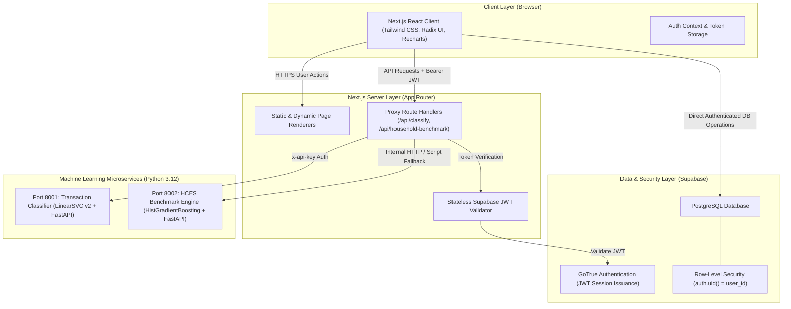

# WealthIQ — College Project Viva & Technical Defense Guide

**Project Title:** WealthIQ — Intelligent Personal Financial Platform  
**Architecture:** Next.js 13.5.1 (App Router) + TypeScript + Tailwind CSS + Supabase PostgreSQL + Python 3.12 FastAPI Microservices  
**Date:** October 2026  
**Document Purpose:** Comprehensive technical preparation for external viva voce examiners, faculty evaluators, and system architecture defense.

---

## 1. Problem Statement & Objectives

### 1.1 Problem Statement
In developing and emerging markets like India, digital payments (especially UPI) have exploded in transaction volume. However, individual and household personal finance management remains fragmented and opaque:
1. **Manual Categorization Friction:** Users must manually tag dozens of unstructured bank SMS or UPI transaction lines (e.g., `UPI/482910/Swiggy/YESB`), leading to tracking abandonment.
2. **Lack of Transparent Fixed-Deposit Intelligence:** Retail depositors struggle to compare term deposit rates across public and private banks. Rate cards differ significantly across tenure buckets (e.g., 7 days vs 1 year vs 5 years), and senior citizen premiums (+0.50% to +0.60%) are often buried in circular PDFs.
3. **Absence of Empirical Socio-Economic Benchmarks:** Existing budgeting tools rely on arbitrary generic rules (like the Western 50/30/20 rule) that do not account for Indian household demographics, state-level price differentials, rural-vs-urban cost of living, or household size.
4. **Black-Box Algorithmic Hallucination:** Many modern financial apps attempt to apply opaque deep learning models or generative AI to budget prediction, producing speculative, non-auditable financial guidance that users and regulators cannot trust.

### 1.2 Core Objectives
WealthIQ solves these challenges through a principled hybrid architecture:
- **Smart Transaction Classification:** A calibrated machine learning microservice combined with regex-based business heuristics to automatically categorize Indian UPI transactions into essential and discretionary buckets with manual user override.
- **Auditable Financial Health Score:** A 100% deterministic, transparent 5-pillar evaluation engine based on empirical personal finance ratios (savings rate, expense burden, debt-to-income, emergency buffer, asset accumulation).
- **Macro-Empirical Household Spending Benchmark:** A machine learning regression model trained on the official **MoSPI Household Consumption Expenditure Survey (HCES) 2023–24** (261,953 households) providing realistic, demographic-specific monthly consumption expenditure benchmarks.
- **Accurate Fixed Deposit Tracking:** Real, verified card rates from major Indian banks (SBI, HDFC Bank, ICICI Bank, RBL Bank) supporting multi-tenure schedules, quarterly compounding calculations, and customer category distinctions.
- **Privacy-First Data Isolation:** Zero data leakage across users enforced at the database layer via PostgreSQL Row-Level Security (RLS) and stateless JWT verification.

---

## 2. System Architecture & Technology Stack



### Technology Stack Justification
| Layer | Technology | Engineering Rationale |
| :--- | :--- | :--- |
| **Frontend Framework** | **Next.js 13.5.1 (App Router)** | Hybrid static/server rendering, fast first-load times, built-in Route Handlers, TypeScript safety. |
| **Styling & UI Components** | **Tailwind CSS + Radix UI** | Responsive, zero-runtime CSS, fully monochrome financial theme, accessible modal/drawer primitives. |
| **Data Visualization** | **Recharts (SVG)** | Declarative SVG charting for net-worth trajectories, expense distributions, and responsive viewports. |
| **Database & Auth** | **Supabase (PostgreSQL 15)** | Relational data integrity, foreign key constraints, GoTrue auth, robust Row-Level Security (RLS). |
| **ML Microservices** | **Python 3.12 + FastAPI + Uvicorn** | High-throughput asynchronous REST inference, lightweight deployment footprints, native scikit-learn integration. |
| **ML Libraries** | **scikit-learn, joblib** | Calibrated linear models and histogram gradient boosting regressors optimized for sub-10ms inference. |

---

## 3. Supabase Authentication, Database & Row-Level Security (RLS)

### 3.1 Authentication Lifecycle
1. **User Registration & Login:** Handled via Supabase GoTrue authentication endpoints using email and password.
2. **Token Issuance:** GoTrue issues an RS256-signed JWT `access_token` (1-hour expiration) and an opaque `refresh_token`.
3. **Stateless Verification:** When the client calls Next.js Route Handlers (`/api/classify-transaction`), the server verifies the JWT using `createClient` with `persistSession: false` without relying on browser cookies or client-side singletons:
   ```ts
   const { data: authData, error: authError } = await supabase.auth.getUser(token);
   if (authError || !authData?.user) return NextResponse.json({ error: 'Unauthorized' }, { status: 401 });
   ```

### 3.2 Database Schema
WealthIQ stores relational data across 8 core tables:
- **`profiles`:** User profile metadata (age, country, employment type, risk tolerance).
- **`income_records`:** Income streams (salary, freelance, dividends, amount, date).
- **`expense_records`:** Individual expenses (`amount`, `category`, `expense_type`: `essential` | `discretionary`, `description`, `record_date`).
- **`savings_records`:** Liquid savings balances (`amount`, `savings_type`, `record_date`).
- **`debts`:** Liabilities (`debt_type`, `original_principal`, `remaining_balance`, `interest_rate`, `monthly_emi`, `remaining_months`).
- **`investments`:** Asset holdings (`asset_type`, `symbol`, `quantity`, `purchase_price`, `current_value`).
- **`fixed_deposits`:** Term deposits (`bank_name`, `principal`, `interest_rate`, `tenure_months`, `start_date`, `maturity_date`, `senior_citizen`).
- **`financial_scores`:** Historical snapshot of the 5-pillar health score.

### 3.3 Row-Level Security (RLS) Defense
Every table enforces PostgreSQL Row-Level Security:
```sql
ALTER TABLE expense_records ENABLE ROW LEVEL SECURITY;

CREATE POLICY "Users can only access their own expenses"
  ON expense_records FOR ALL
  USING (auth.uid() = user_id)
  WITH CHECK (auth.uid() = user_id);
```
**Why RLS is Critical for Viva Defense:** Even if an attacker steals an API key or performs a malicious SQL query on the client, PostgreSQL automatically injects `WHERE user_id = auth.uid()` into every query. Unauthenticated queries or queries targeting other user IDs return 0 rows. Verified in Phase 20 E2E tests (`anonSupabase.from('expense_records').select('*')` returns 0 rows).

---

## 4. The Five-Pillar Deterministic Financial Health Score

### 4.1 Why Deterministic Instead of Machine Learning?
In financial engineering, scores that govern user recommendations or risk assessments must be:
1. **Explainable:** A user must know exactly why their score changed from 75 to 85.
2. **Auditable:** A financial advisor or examiner can reproduce the calculation on paper.
3. **Zero Bias / Non-Hallucinatory:** Avoids black-box ML models penalizing users due to biased historical training datasets.

### 4.2 Mathematical Formulation & Pillar Weights
The Financial Health Score is an integer from 0 to 100 calculated as:

$$\text{Health Score} = \sum_{i=1}^{5} \left( \text{Score}_i \times \text{Weight}_i \right)$$

| Pillar | Weight | Metric Evaluated | Benchmark Thresholds & Scoring Logic |
| :--- | :---: | :--- | :--- |
| **1. Savings Behavior** | **25%** | Monthly Savings Rate $\left( \frac{\text{Income} - \text{Expenses}}{\text{Income}} \right)$ | $\ge 30\% \rightarrow 100$, $\ge 20\% \rightarrow 85$, $\ge 10\% \rightarrow 65$, $> 0\% \rightarrow 45$, $\le 0\% \rightarrow 10$. |
| **2. Expense Burden** | **25%** | Total & Discretionary Expense Ratios | Expense Ratio $\le 50\% \rightarrow 100$, $\le 70\% \rightarrow 80$, $> 90\% \rightarrow 25$. Discretionary ratio $\le 20\%$ adds bonus points. |
| **3. Debt Burden** | **20%** | Debt-to-Income Ratio $\left( \frac{\text{Monthly EMI}}{\text{Monthly Income}} \right)$ | $\text{DTI} = 0\% \rightarrow 100$, $\le 20\% \rightarrow 85$, $\le 40\% \rightarrow 65$, $> 50\% \rightarrow 20$. |
| **4. Emergency Fund** | **15%** | Liquid Buffer $\left( \frac{\text{Liquid Savings}}{\text{Monthly Essential Expenses}} \right)$ | $\ge 6\text{ months} \rightarrow 100$, $\ge 3\text{ months} \rightarrow 80$, $\ge 1\text{ month} \rightarrow 50$, $< 1\text{ month} \rightarrow 15$. |
| **5. Investments & Assets**| **15%** | Asset Diversification & FD Holdings | Liquid savings + active investments + FD principal evaluated against total debt. Positive net asset ratio $\rightarrow 80\text{--}100$. |

### 4.3 Health Categories
- **80–100:** *Excellent* (Exceptional resilience across savings, debt obligations, and accumulated assets)
- **65–79:** *Good* (Solid financial baseline; minor opportunities in debt reduction or emergency buffer)
- **50–64:** *Fair* (Moderate vulnerability; debt or discretionary expenses require attention)
- **35–49:** *Poor* (High vulnerability; negative cash flow or excessive debt-to-income)
- **0–34:** *Critical* (Severe financial stress; expenses exceed income, emergency reserves exhausted)

---

## 5. Smart Transaction Categorization Microservice

### 5.1 Architecture & Pipeline
- **Runtime:** Python 3.12 / FastAPI microservice on Port 8001.
- **Model Pipeline:** Calibrated Linear Support Vector Classifier (`CalibratedClassifierCV` wrapping `LinearSVC`).
- **Feature Extraction:** `TfidfVectorizer` with character and word n-grams:
  - Word n-grams: `(1, 2)` (captures phrases like "uber trip", "electricity bill").
  - Character n-grams: `(3, 5)` (captures abbreviated UPI merchant tokens like `swg`, `zom`, `irctc`).
- **Output Categories (9 WealthIQ Schema Categories):**
  1. `Food` (essential)
  2. `Housing` (essential)
  3. `Transportation` (essential)
  4. `Utilities` (essential)
  5. `Healthcare` (essential)
  6. `Entertainment` (discretionary)
  7. `Shopping` (discretionary)
  8. `Personal` (discretionary)
  9. `Education` (essential)

### 5.2 Hybrid Rule Engine & Pre-Filters
Pure ML models struggle on edge cases like salary credits or ambiguous UPI codes. WealthIQ wraps the classifier in a deterministic hybrid pre-filter:
1. **Income Redirection Rule:** If a description contains `"salary"`, `"payroll"`, `"dividend"`, `"interest credit"`, the rule engine flags `isIncome: true` and alerts the user to record it under the Income module instead of Expenses.
2. **High-Confidence Merchant Rules:** Exact matches for common Indian digital merchants (Swiggy, Zomato, Zepto, Blinkit, Uber, Ola, BESCOM, Tata Power, Netflix, Amazon) receive instantaneous deterministic category assignment with 0.95+ confidence.
3. **ML Prediction Fallback:** Unmatched or unstructured descriptions are passed to the LinearSVC pipeline, returning predicted category and probability distribution.
4. **Human-in-the-Loop Override:** In the UI (`app/expenses/page.tsx`), the ML suggestion is merely a pre-fill. The user can review, edit, or override the category before submitting.

### 5.3 Limitations & Edge Cases
- **Ambiguous UPI Codes:** A transaction like `UPI/9820192831/PAY` contains no merchant signal. The model correctly returns low confidence and prompts manual user assignment.
- **Privacy Boundary:** WealthIQ does not silently read user SMS inbox or banking apps. All transactions are submitted via user input or file upload.

---

## 6. Expense Forecasting: Why Next-Month Estimator Remains Deterministic

### 6.1 Scientific Rationale
A common examiner question is: *"Why didn't you train an LSTM, Transformer, or ARIMA model for monthly expense forecasting?"*

**The Answer:**
1. **Sample Size Reality:** In personal finance apps, a typical user has between 1 and 12 months of recorded history. Sequence models (LSTMs) and ARIMA require dozens or hundreds of sequential data points to learn seasonal patterns without catastrophic overfitting.
2. **Irregularity & Non-Stationarity:** Personal expenses vary wildly due to life events (vacations, medical emergencies, annual insurance premiums) which are not periodic cycles.
3. **Deterministic Moving Averages are Robust:** Financial industry best practice (and personal budgeting standards) favors moving averages because they adapt to recent spending shifts without fabricating speculative patterns.

### 6.2 Tiered Deterministic Methodology
WealthIQ implements a 4-tier forecasting engine based on data maturity:

$$\text{Tier 0 (< 3 months)}: \quad \text{Deterministic Run-Rate} = \frac{1}{N} \sum_{i=1}^{N} \text{Total}_i$$

$$\text{Tier 1 (3–5 months)}: \quad \text{3-Month SMA} = \frac{\text{Total}_{t} + \text{Total}_{t-1} + \text{Total}_{t-2}}{3}$$

$$\text{Tier 2 (6+ months)}: \quad \text{6-Month EWMA} (\alpha = 0.5) = \sum_{k=0}^{5} \alpha(1-\alpha)^k \text{Total}_{t-k}$$

$$\text{Tier 3 (12+ months)}: \quad \text{Dormant ML Flag} \rightarrow \text{Preserves Heuristic Fallback}$$

- **Non-Negative Invariant:** Estimates are strictly bounded below by ₹0.
- **Logging Gap Detection:** If months are missing (e.g., recorded in June and August, but skipped July), the engine flags a data limitation warning without fabricating a ₹0 month.

---

## 7. The HCES 2023–24 Household Spending Benchmark Model

### 7.1 Dataset Provenance & Scale
- **Source:** Ministry of Statistics and Programme Implementation (MoSPI), Government of India.
- **Survey:** Household Consumption Expenditure Survey (HCES) 2023–24.
- **Survey Period:** August 2023 – July 2024 (released in 2024/2025).
- **Scale:** **261,953 surveyed Indian households** across all 36 States and Union Territories.
- **Target Variable:** Monthly Per Capita Consumption Expenditure (**MPCE**) in INR.

### 7.2 Features Used
1. `state` (36 States/UTs, e.g., Maharashtra, Karnataka, Delhi, Bihar)
2. `sector` (`rural` vs `urban`)
3. `highest_education` (`below_primary`, `primary_middle`, `secondary_higher`, `graduate_above`)
4. `livelihood` (`regular_wage`, `self_employed`, `casual_labour`, `other`)
5. `dwelling_type` (`pucca`, `semi_pucca`, `katcha`)
6. `cooking_fuel` (`lpg`, `png_electric`, `firewood`, `other`)
7. `land_owned` (`owned`, `not_owned`)
8. `hh_size` (Household size, integer 1 to 25)
9. `num_adults` (Number of adult members)
10. `num_children` (Number of children)

### 7.3 Training Process & Model Architecture
- **Algorithm:** `HistGradientBoostingRegressor` (Histogram-based Gradient Boosting Decision Tree).
- **Why this model?**
  - Native support for categorical features without sparse one-hot explosion.
  - Non-linear interactions between demographic features (e.g., urban graduate households have vastly different expenditure elasticity compared to rural casual labour households).
  - High inference efficiency: compact model artifact (**0.23 MB**), sub-5ms inference.
- **Data Split:** 80% Training ($N = 209,603$), 20% Held-Out Test ($N = 52,350$).

### 7.4 Verifiable Evaluation Results (Held-Out Test Set)
Directly verifiable from `ml/models/hces_benchmark_metadata.json`:

| Model / Baseline | Test MAE (₹/person/mo) | Test RMSE (₹/person/mo) | Test $R^2$ Score |
| :--- | :---: | :---: | :---: |
| **Naive Weighted Mean Baseline** | ₹5,593.17 | ₹8,810.93 | -0.0019 |
| **Baseline Median** | ₹5,270.22 | ₹9,081.62 | -0.0644 |
| **Linear / Ridge Regression** | ₹4,019.84 | ₹6,630.93 | 0.4325 |
| **HistGradientBoosting (WealthIQ)** | **₹3,461.22** | **₹5,834.94** | **0.5606 (56.1%)** |

**Segment Breakdown:**
- **Rural Households:** Test MAE = **₹2,354.67**, Test $R^2 = 0.4359$
- **Urban Households:** Test MAE = **₹5,532.15**, Test $R^2 = 0.4751$

### 7.5 Model Purpose & Limitations
- **Purpose:** Macro-benchmark that provides users with an empirical reference of typical spending for comparable households in their state and sector.
- **Limitations:**
  - Measures consumption expenditure, not savings or investment capacity.
  - Survey recall bias and top-percentile expenditure variance in metro cities.
  - It is a population baseline, not personal financial advice.

---

## 8. Fixed-Deposit Rate Sourcing & Compounding Engine

### 8.1 Official Banking Data (October 2026)
WealthIQ incorporates card rates applicable in October 2026 for retail domestic term deposits (< ₹3 Crore):

- **State Bank of India (SBI):** 12M rate = 6.25% (Senior: 6.75%), circular 15/12/2025.
- **HDFC Bank:** 12M rate = 6.25% (Senior: 6.75%), circular 19/08/2026.
- **ICICI Bank:** 12M rate = 6.25% (Senior: 6.75%), circular 09/10/2026.
- **RBL Bank:** 12M rate = 7.40% (Senior: 8.00%), circular 01/10/2026.

### 8.2 Compounding Mathematics
In Indian banking practice, fixed deposits compounded quarterly follow the standard compound interest formula:

$$A = P \times \left(1 + \frac{r}{n \times 100}\right)^{n \times t}$$

Where:
- $P$ = Principal amount (INR)
- $r$ = Annual interest rate percentage (e.g., 6.25%)
- $n = 4$ (Quarterly compounding frequency)
- $t = \frac{\text{tenure\_months}}{12}$ (Tenure in years)

$$\text{Total Interest Earned} = A - P$$

Implemented accurately in `app/fd/page.tsx` and validated across multi-tenure schedules.

---

## 9. API Architecture & Security Boundaries

### 9.1 Stateless Proxy Route Architecture
Client components never communicate directly with internal Python microservices. All external network interactions pass through Next.js Route Handlers:

1. **Authentication Gate:** The Route Handler inspects `Authorization: Bearer <JWT>`. If absent or invalid, returns HTTP 401.
2. **Server-to-Server Secret:** The Route Handler attaches an internal secret (`x-api-key`) when proxying requests to the Python microservices.
3. **Timeout AbortController:** Requests to upstream microservices are wrapped in an `AbortController` (4,500ms timeout) preventing hangs.
4. **Resilient Fallback:** If the microservice is temporarily unreachable, the route returns structured JSON (`available: false`) allowing the UI to degrade gracefully without crashing.

---

## 10. Anticipated Viva Questions & Examiner Defense

### Q1: What makes WealthIQ different from standard budgeting apps?
**Answer:** "Most budgeting apps either enforce arbitrary rules (like 50/30/20) or require tedious manual transaction tagging. WealthIQ introduces three architectural innovations:
1. An empirical **Household Spending Benchmark** trained on 261,953 households from the official MoSPI HCES 2023–24 survey, giving users realistic, state- and sector-specific expenditure expectations.
2. A **smart UPI transaction classifier** (Calibrated LinearSVC) tailored to Indian merchant descriptions with hybrid rules and user override.
3. A **deterministic 5-pillar financial health score** that is 100% transparent and auditable, deliberately avoiding opaque black-box AI."

### Q2: Why did you use scikit-learn instead of Deep Learning (PyTorch/TensorFlow) for the classifier and benchmark?
**Answer:** "For tabular survey data and short text strings, tabular GBDTs and linear SVMs consistently outperform deep neural networks in both accuracy and operational efficiency:
- `HistGradientBoostingRegressor` handles categorical survey features natively with zero latency overhead (model size is only 0.23 MB vs 100+ MB for neural nets).
- `LinearSVC` with TF-IDF n-grams delivers sub-10ms classification on transaction strings without requiring expensive GPU infrastructure.
- In financial products, inference speed, cold-start latency on serverless platforms, and computational cost are primary engineering considerations."

### Q3: How do you guarantee user privacy and data security?
**Answer:** "We enforce data protection at three architectural boundaries:
1. **Database Layer:** PostgreSQL Row-Level Security (RLS) ensures that every query is bound to `auth.uid() = user_id`. No user can query or modify another user's financial records.
2. **Stateless JWT Verification:** All Next.js Route Handlers verify cryptographic JWT sessions on the server without relying on insecure client storage.
3. **No Direct Microservice Access:** Python ML microservices reside on a protected internal network accessible only via server-to-server API secrets."

### Q4: How is the next-month expense forecast calculated, and why not use ML for it?
**Answer:** "Next-month expense estimation uses a deterministic tiered moving-average heuristic (3-month SMA or 6-month EWMA with $\alpha = 0.5$). We explicitly do not use ML here because personal financial histories have far too few data points (typically 3 to 12 months), which causes sequence models to severely overfit. A transparent, non-negative moving average provides reliable, auditable trend expectations without fabricating non-existent seasonality."

### Q5: What are the verified metrics of your HCES model?
**Answer:** "Trained on 209,603 households and evaluated on a held-out test set of 52,350 households from MoSPI HCES 2023–24:
- The overall model achieves a **test MAE of ₹3,461.22/person/month** and an **$R^2$ of 0.5606** (56.06% variance explained).
- It significantly outperforms the baseline weighted mean ($R^2 = -0.0019$) and ridge regression ($R^2 = 0.4325$).
- In rural households, test MAE is **₹2,354.67** ($R^2 = 0.44$).
- In urban households, test MAE is **₹5,532.15** ($R^2 = 0.48$), reflecting greater spending variance in metro tiers."

---

## 11. Known Limitations & Future Work

### 11.1 Known Limitations
1. **Unstructured UPI Descriptions:** Peer-to-peer UPI transfers with arbitrary descriptions (e.g., `UPI/9820/TRANSFER`) cannot be categorized automatically by any model and require manual user tagging.
2. **Offline Microservice Hosting:** In local development, microservices run on ports 8001 and 8002; while the classifier is deployed to Vercel preview, the HCES benchmark currently runs locally and requires containerization for cloud deployment.
3. **Self-Reported Financial Data:** Outside of automated categorization, financial balances depend on user transaction logging.

### 11.2 Future Roadmap
1. **Automated Account Aggregator (AA) Integration:** Integrate with RBI-regulated Account Aggregator APIs for consent-based direct bank statement synchronization.
2. **Bank Statement OCR / PDF Parsing:** Add client-side parsing of uploaded bank e-statements with zero server-side credential storage.
3. **Section 80C Tax Planning:** Expand the fixed-deposit engine to automatically calculate Section 80C tax-saving deposit deductions and lock-in periods.
4. **Cloud Run Microservice Containerization:** Package the HCES benchmark into a multi-stage Docker container deployed to Google Cloud Run or AWS Fargate.
